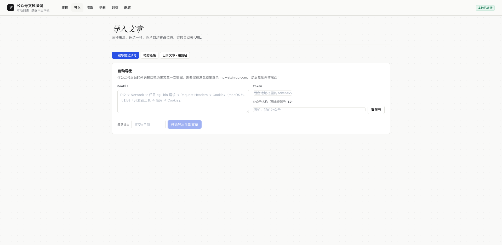
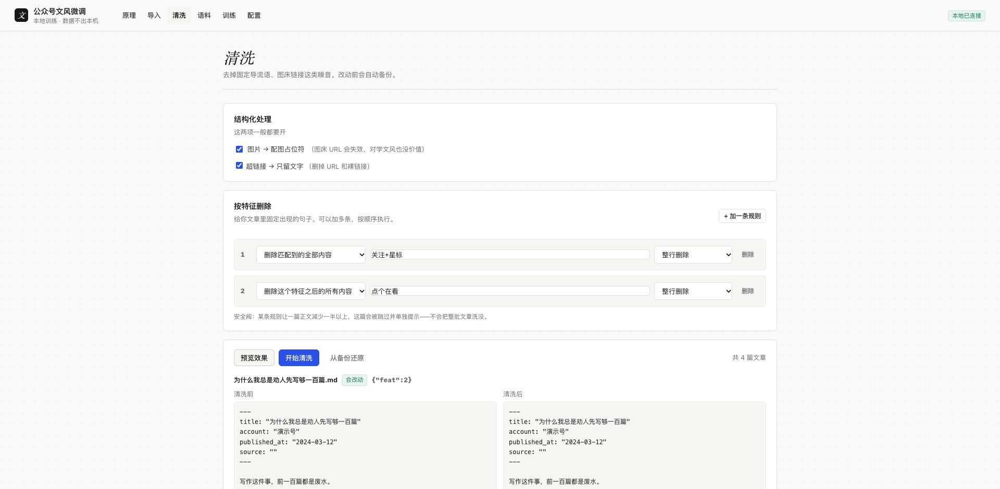
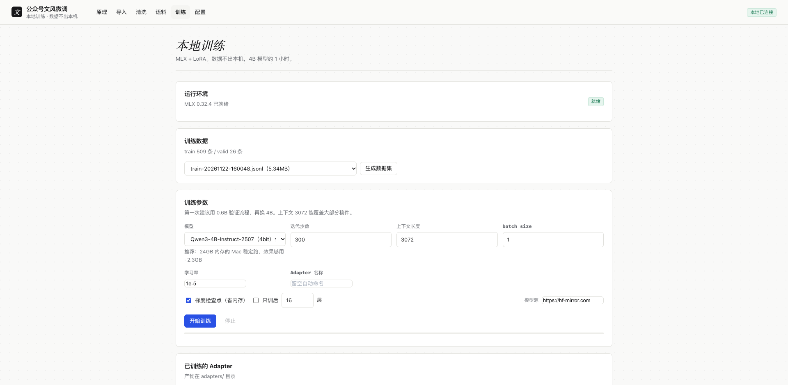

# 公众号文风微调

用自己的公众号文章，在你的 Mac 上微调一个「会把 AI 稿改成你的写法」的本地模型。

零服务端、零账号、数据不出本机。造语料部分跨平台，训练只支持 macOS（Apple Silicon + MLX）。


---

## 不想碰命令行？下载即可开箱使用

非技术背景 / 只是想快点用上的话，不用敲任何命令：

**推荐：下载 `.dmg`**

1. 打开 [Releases](https://github.com/comeonzhj/wechat-style-finetune/releases)，下载 `wechat-style-finetune-1.0.0.dmg`
2. 双击打开，把「公众号文风微调」拖进 Applications
3. 双击启动 → 会弹出一个终端窗口显示进度，浏览器自动打开界面

> 这个包已经用 Developer ID 签名并完成 Apple 公证（notarized），**双击即可，不会弹「无法验证开发者」**。

**备用：下载 zip**

适合想直接看源码、或者不想让它装进「应用程序」的人：

1. 下载 `wechat-style-finetune-v1.0.0.zip` 并解压
2. 双击文件夹里的 `启动.command`
3. 首次会被 macOS 拦一次：右键点它 → 选「打开」→ 再点「打开」

第一次启动都会自动准备环境（约 2 分钟，走国内镜像），之后每次秒开。

## 为什么需要它

通用模型能写「一篇文章」，写不出「**你**的一篇文章」。区别不在内容，在声音：

- 你习惯短段落，它爱写工整小标题
- 你会说「我上周试了一下」，它只会说「值得注意的是」
- 你会吐槽，它会在结尾加一句「总而言之」

这些东西没法用 prompt 描述清楚——「犀利一点」是你的犀利还是我的犀利？

唯一有效的办法是让它从你的文章里学。但直接拿文章训练没用：模型会学到「这个话题下大概写这些内容」，而不是「怎么说话」。

所以要构造训练数据：**输入是没人味的通用稿，输出是你的原文**。模型学到的就只剩「怎么把没人味的稿子变成你的」。

---

## 四步流程

```
导入文章  →  清洗  →  造语料  →  本地训练
（三种来源）  （多规则） （AI 稿↔你的稿） （MLX LoRA）
```

### 第 1 步：导入（三种来源任选）



**① 一键导出公众号全部文章**（最省事）

网页里填两样东西：

1. **Cookie**：浏览器登录 `mp.weixin.qq.com` → F12 → Network → 任意 `cgi-bin` 请求 → Request Headers 里的 Cookie
2. **Token**：后台地址栏里的 `token=xxxxx`

再填公众号名称，点「查账号」拿到账号 ID，就能一次把历史文章全导下来。
每页间隔 1.2 秒避免风控；遇到 `200013` 会提示等 10 分钟再来。

> 用的是公众号后台的列表接口（`cgi-bin/appmsg`），不碰任何私有能力，只读你自己账号的文章。

**② 粘贴文章链接**：每行一个 `mp.weixin.qq.com/s/...`，只抓公开页面，不需要登录。

**③ 已有文章给路径**：填一个目录（递归找 `.md`）或几个 `.md` 文件的绝对路径。
目前只支持 Markdown，其它格式请先自己转一下；没有 frontmatter 的会自动补一份。

导入时自动做两件事：图片 → `<!-- 配图 -->` 占位符，超链接 → 只留文字。
因为图床 URL 会失效、跳转参数是噪音，都学不到文风。

### 第 2 步：清洗



你的文章里一定有固定出现的句子：「关注+星标，进群领资料」「点个在看」这类。
它们每篇都一样，模型会把它们当成「文风」学进去——最后生成的文章结尾都会带一句「关注+星标」。

工具只提供三个动作，但**可以叠加任意多条规则，按顺序执行**：

| 动作 | 用途 |
|---|---|
| 删除匹配到的全部内容 | 「关注+星标」这类固定尾巴 |
| 删除某特征之前的所有内容 | 文首的栏目介绍、往期推荐 |
| 删除某特征之后的所有内容 | 文末的二维码、版权声明 |

典型组合：第一条「删除之前」切掉文首的自我介绍，第二条「删除之后」切掉文末的二维码，
第三条「删除全部」清掉正文里反复出现的引流句。

**安全阀**：如果某条规则会让一篇正文减少一半以上，这篇会被跳过并单独提示。
批量操作最怕一条规则把整批文章洗没。首次写入前会自动备份，随时可还原。

### 第 3 步：造语料（核心）

每篇文章跑一条流水线：

1. **提取事实**——拆成结构化事实清单，每条不超过 40 字，引用原文用「」标出
2. **去风格**——逐字段把「我觉得」「我上周」这类表述改成客观陈述（反复打补丁，直到干净）
3. **造通用稿**——2–3 家模型（任意 OpenAI 兼容接口）各写一版
4. **裁判打分**——按 rubric 选最像「通稿」的那篇，并判断改写质量
5. **配对**——`通用稿 → 你的原文`，长文自动按段落切成 2000–3000 字的片段

产出 `train-*.jsonl`（训练）和 `eval-*.jsonl`（评测）。

**关键设计：三解耦。** 内容、结构、声音三者里，只让「声音」成为变量。
如果通用稿和你的原文在事实或结构上也不一样，模型就会学歪。

### 第 4 步：本地训练



| 模型 | 内存 | 说明 |
|---|---|---|
| Qwen3-0.6B·4bit | ~2GB | 只用来验证流程通不通 |
| Qwen3-1.7B·4bit | ~4GB | 能跑，文风偏平 |
| **Qwen3-4B-Instruct-2507·4bit** | **~8GB** | **推荐**，24GB Mac 稳定跑，约 1 小时 |
| Qwen3-8B·4bit | ~14GB | 24GB 贴上限，必须开梯度检查点 |

训练完的 adapter 在 `adapters/`，只有几十 MB。

---

## 快速开始

```bash
git clone https://github.com/comeonzhj/wechat-style-finetune.git
cd wechat-style-finetune
./setup.sh      # 只装 mlx-lm，走国内镜像，约 2 分钟
./start.sh      # 自动打开 http://127.0.0.1:8765
```

要求：

- macOS + Apple Silicon（M1/M2/M3/M4）——训练需要 MLX
- Python 3.10+（其余零依赖，全用标准库）
- 造语料需要任意一家 OpenAI 兼容的模型 API，在「配置」页填

**国内网络**：`setup.sh` 默认阿里云 PyPI 镜像（实测比清华快 20 倍）；
模型默认从 `hf-mirror.com` 下载，不用科学上网。改 `HF_ENDPOINT` 可换源。

---

## 为什么这样设计

**1. 指标先行。** 训完读一遍「好像有点像？」是最容易走错路的地方。四个可量化指标：

| 指标 | 坏了说明什么 |
|---|---|
| 长度比 | 稳定低于 0.8 = 模型在偷懒压缩 |
| 重合度（最长公共子串） | 超过 25 字 = 在照抄输入 |
| 第一人称密度 | 掉到 2 以下 = 写成了通稿 |
| 小标题数 | 明显多于原文 = 退回通用排版习惯 |

**2. 先小后大。** 0.6B 跑 50 步验证流程，4B 跑 300 步看效果。别一上来就冲 8B。

**3. 数据质量 > 模型规模。** 500 对精挑细选的语料，效果远好于 5 万条爬来的。

**4. 每一步都能单独重跑。** 导入、清洗、造语料、训练都是独立环节，数据都在本地文件里。

---

## 目录结构

```
app/
  server.py          # HTTP 服务 + 语料流水线（纯标准库）
  importer.py        # 公众号抓取 / HTML → Markdown
  wxmp.py            # 公众号后台列表接口（一键导出全部文章）
  cleanup.py         # 清洗规则 + 安全阀
  trainer.py         # MLX 训练任务管理
  studio.py          # 产品层接口
  static/            # 前端（无框架、无构建）
prompts/             # 流水线提示词（可直接改）
docs/                # 复盘文章、设计说明
my-articles/         # 你的文章（.md，运行时生成）
data/exports/        # 导出的训练语料
adapters/            # 训练产物
```

---

## 常见问题

**训练 OOM / 电脑卡死？**
换 4B 并勾选梯度检查点；或把上下文长度从 3072 降到 1024。8B 在 24GB 机器上要开检查点且只训后 16 层。

**loss 一直是 nan？**
上下文太短，assistant 部分被截掉了。调到 2048 以上。

**模型下载很慢？**
确认 `HF_ENDPOINT=https://hf-mirror.com`。首次下载 0.4–4.5GB，之后走本地缓存。

**训完感觉没变化？**
先看「第一人称密度」。掉到 2 以下多半不是容量问题，而是 system prompt 里有负向约束
（比如「不要新增任何事实」）把写「我」的意愿压住了——这是复盘里最反直觉的一个坑。

**想用更大的模型？**
本机只到 8B。再大就要租 GPU 跑 LLaMA-Factory，本仓库导出的 `messages` 格式和它兼容。

---

## 能力边界

能学到：段落节奏、人称习惯、口头禅、比喻方式、开头和收尾的套路、对读者的称呼。

学不到：**你为什么这么想。** 模型学到的是「我说『我觉得』时后面跟一个判断」，
不是「我为什么在这个地方判断」。

所以它能把「写稿」这一步接过去，不能替「想」。

---

## License

MIT
