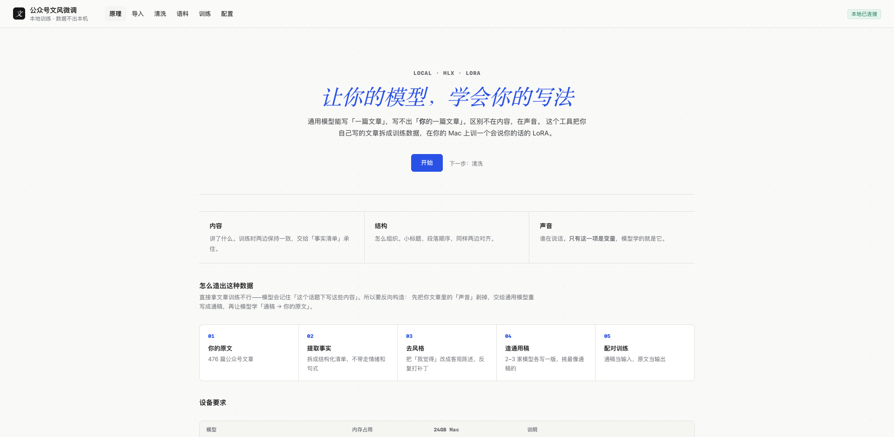
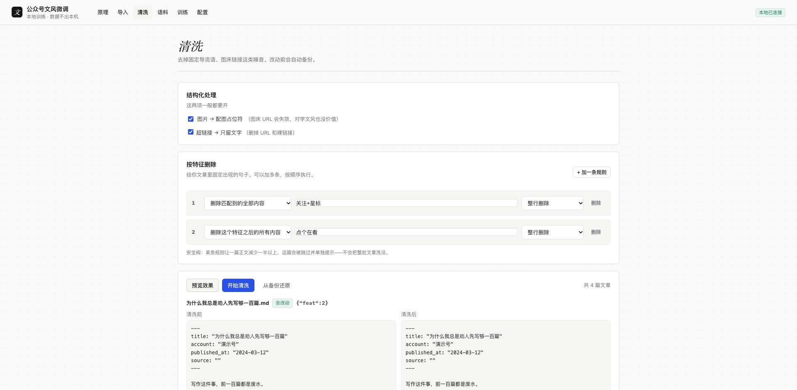
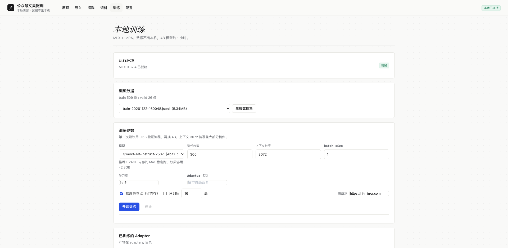
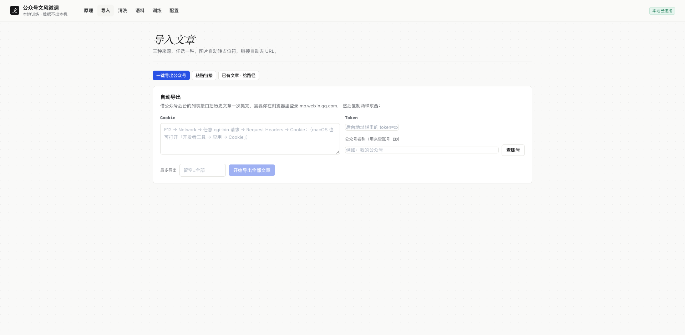

# 我用自己的 476 篇公众号文章，微调了一个改写模型

**TL;DR：**

- 一个 4B 模型，用别人的稿子训练，可以写出有「我」的公众号文
- 我把整个过程做成一个开源工具，本地网页一戳就跑
- 复盘踩过的坑、数据、工程细节

先放一张结果：



## 为什么从“写稿”变成“微调”

你让 AI 写文章时，有没有这种体验：

- 开头很硬，但读完就软
- 每一段都像被格式化过：短句、小标题、「总而言之」
- 全文没有「我」，没有「你」，没有活人

这不是能力问题，是「声音」问题。

我的文章为什么有声音？

我写了 476 篇公众号，从 2023 年到现在。

每一篇都有我的口头禅、我的比喻方式、我骂人的方式、我收尾的习惯。

这些东西没法用 prompt 描述——「犀利一点」是你的犀利还是我的犀利？

所以我决定：不描述，让它学。

## 一个反直觉的设计

我一开始的想法是：拿我的文章训练模型，让它模仿。

但后来发现不行。

微调的本质是学「输入→输出」的映射。如果我把「随便一个话题」作为输入，「我的文章」作为输出，模型学到的是「在这个话题下，写几千个字」，而不是「怎么写得像我」。

真正有效的方法是：

1. 把我的文章，去掉「我的声音」，保留事实和结构
2. 把去过的文章给通用模型，让它重写成一篇「通稿」
3. 用「通稿」作为输入，原文作为输出，训练模型学「声音」

| 内容 | 选题 | 训练时两边保持一致 |
| --- | --- | --- |
| 结构 | 逻辑 | 两边保持一致 |
| 声音 | 你 | **这是唯一变化的部分** |

我把这个方法叫做「三解耦」。

**关键：AI 稿和原文之间，除了声音，不能有其他差异。**

如果我第一版偷懒，只做了「去第一人称」，模型会学到「把第一人称改成第三人称」，方向反了。

## 数据流水线

整个流程分五步：

1. **分类**：按年份、类型、有没有软广分类。2023 年之前的不学，文字我已经不认了。
2. **提取事实**：把文章拆成结构化事实清单。每段不超过 40 字，引用原文用「」标出。这一步最难，模型天然爱总结、爱加戏。
3. **去风格**：逐字段检查，把描述性、带情绪的表达换成平铺直叙。反复打补丁，极端样本从 55 处泄漏清到 0，花了 4 轮。
4. **造通用稿**：用三家模型（DeepSeek、MiMo、豆包）各写一版，prompt 一样。三家不一样，正好给我挑。
5. **裁判打分**：用 rubric 选最像「通稿」的那篇。裁判标准改到 v6 才好用，早期它一直在扣「没有小标题」「没有结尾号召」，而那些恰恰是我要去掉的东西。

最后得到 535 对训练数据 + 86 对评测数据。

清洗这一步没法省。

624 条输出里有 380 条结尾带着「关注+星标+进群」，这是公众号的固定尾巴，不是文风。不清掉，模型会给所有稿子加这个收尾。

这是工具里的清洗页：



可以叠加多条规则，

`删除特征之前/之后`配合`整行删除`，一次洗完。

还有个安全阀：如果把正文砍掉一半以上，会被拦住，避免批量操作把语料洗没。

## 指标比感觉靠谱

模型训完会给你一段文字，你读一遍：

> 嗯……好像有点像？又好像不太像。

然后你调参数，再训一次，再读一遍。

三天过去，你什么也没确定。

所以我一开始就定了四个可量化的指标：

| 指标 | 怎么算 | 说明什么 |
| --- | --- | --- |
| 长度比 | 生成字数 ÷ 原文字数 | 稳定低于 0.8 = 模型在偷懒压缩 |
| 重合度 | 与输入的最长公共子串 | 超过 25 字 = 在照抄输入 |
| 第一人称密度 | 「我」出现次数 | 掉到 2 以下就是写成通稿了 |
| 小标题数 | Markdown 标题行数 | 我的原文几乎不用小标题 |

前两个是关键。

长度对了但「我」没了，就是典型的「形似神不似」——它抄了你的段落长度，没抄你说话的方式。

指标本身也会骗人。我踩过两次：

**第一次：度量写错了**

指标报「最长公共子串 63 字」，我以为模型在照抄。查了半天发现是度量写错了——它把我提取的事实清单里的专有名词也算进了重合度。事实本来就该一致，怎么能算抄袭？

**第二次：评测样本不均衡**

脚本默认取前 12 条样本，我拿这个数字做了半天判断。后来才发现这 12 条恰好是「我」密度最高的（平均 13.3 次），而全部 86 条的平均只有 7.8。样本选偏了，结论就偏了。

## 先跑小的，再跑大的

我的笔记本是 M4，24GB 统一内存。

这个配置能跑多大？4B 舒服，8B 贴着上限，14B 别想。

一开始训练就 OOM，跑到第 129 步炸的，Metal 直接报 `kIOGPUCommandBufferCallbackErrorOutOfMemory`。

加上梯度检查点之后峰值从 8.7GB 降到 4.7GB，能跑了，但速度是 56 token/s。

所以我的路线是：

1. 本地用 0.6B 和 4B 做小规模验证（120 步，几十分钟），确认数据和指标是对的
2. 再去云端租 24GB 卡跑完整训练

本地那一轮的结果给了我信心：文风距离从 0.851 降到 0.50，15 个样本里 13 个变好。

虽然还糙，但方向对了。

后来这套「小模型验证 → 大模型正式跑」的节奏被固化进了工具里：



## 踩过的坑（但不会让你踩）

训练本身只占三成时间。剩下七成是工程问题，每一个都能让你卡两小时。

挑四个：

### 坑 1：5.02 GiB 显存去哪了？

第一次云端训练，18 秒就 OOM：

```
torch.OutOfMemoryError: CUDA out of memory. Tried to allocate 5.02 GiB\
```

我第一反应是模型太大。但算一下：

```

5.02 GiB ≈ 8192（序列长）× 16.4 万（词表）× 4 字节（fp32）\
```

这是**整个词表的 logits 转成 fp32** 的张量。跟模型大小无关，是长上下文必然的代价。

所以我之前的判断错了：不是模型太大，是序列太长撑不住。把 batch 降到 1 之后，问题就消失了。

### 坑 2：评测跑出来全是英文

第一次跑评测，三个不同 checkpoint 的指标**一模一样**：长度比 2.39，第一人称 0.2。输出是一屏英文的 `Thinking Process`。

不是模型没学到，是我 prompt 里写错了一个 token。

Qwen3.5 的对话模板把「空思维链」放在 prompt 里，关闭思考时必须是：

```
\

<tool_call>thinking\
\
</think>\
没有思考内容\
\
<tool_call>expectation\
```

我手滑多写了一个斜杠，被 tokenizer 切成了 4 个垃圾 token。

模型看到一堆乱码，直接进入思考模式，一屏推理全吐出来。

这个坑最阴险：**训练 loss 照常下降，看起来一切正常**。唯一的排查办法是把 prompt 打印出来，和官方模板逐字节比。

### 坑 3：负向指令杀死了「我」

第二轮训完，各项指标都正常，就是第一人称从 0 变不出来。

我查数据：训练集里我的原文「我」出现 7 次（中位），AI 稿是 0 次。

任务很简单：把无人称稿改成第一人称叙述。

为什么学不会？

因为 system prompt 最后一句：

```
保留原文全部事实、数字与专名，不要新增任何事实。
```

对模型来说，「我说我干了什么」就是在新增事实。这句话把它吓住了。

我改成：

```

不要编造原文没有的具体数字或事实，\
\
但可以用「我」表达观点和经历。\
```

同一批权重，「我」从 2 涨到 5，小标题从 5 个变成 0 个。

### 坑 4：训好的模型加载不了

训完导出 GGUF，丢进 Ollama，报：

```

tensor 'blk.0.ssm_beta.weight' not found\
```

原因是版本错配：llama.cpp 新版把 Qwen3.5 的两个共享输入权重合并了（`ssm_beta + ssm_alpha → ssm_beta_alpha`），而 Ollama 内置的 llama.cpp 比较旧，还按老名字找。

解法是关掉转换时的合并逻辑，产出老式布局。新版运行时两种名字都认，所以未合并的文件新旧通吃。

顺便，Ollama 0.40 会把输出自动归类。不显式关闭思考的话，正文全被塞进 `thinking` 字段，`content` 返回空——你会以为模型没说话。

## 结果和还没解决的问题

最终这一版：Qwen3.5-4B，LoRA rank 32，4 个 epoch，1072 步。

两个评测样本结果：

| | 生成 | 原文 |
| --- | --- | --- |
| 样本 1 | 2008 字，「我」8 次 | 2046 字，「我」12 次 |
| 样本 2 | 2411 字，「我」10 次 | 2046 字，「我」12 次 |

上一版同样的指标是 **2 次**。

生成的开头：

> 「过剩」不是「暂时失业」，而是「被时代抛弃」。
>
> 前段时间看《工作、消费主义和新穷人》这本书……深感忧心的同时，又觉得特别「扎心」。

长度准了，声音回来了，「总而言之」没了。

**还没解决的：**

- 小标题还是偏多（生成 4 个，原文 0 个）。4B 的容量到这里有点吃力，下次要么在 prompt 里硬约束，要么把带小标题的样本从数据里剔掉
- 「我」到 10 就上不去。目标 12。差的那两次，是那种需要具体生活细节的段落，模型不敢编

## 工具怎么用

我把整条流程做成了一个工具：

- 导入：公众号链接批量抓取，也可以直接给本地 md 路径
- 清洗：按特征删掉固定的导流语，可以叠加多条规则
- 训练：在 Mac 上本地跑，不让数据出本机
- 看指标、看结果



不想碰命令行的话，[Releases](https://github.com/comeonzhj/wechat-style-finetune/releases) 里有个 `.dmg`：

下载 → 双击 → 把图标拖进「应用程序」 → 双击启动。

第一次会自动准备环境（约两分钟，走国内镜像），之后就是浏览器直接打开了。

这个包我用开发者证书签了名，也过了 Apple 公证，所以不会出现「无法验证开发者」那种弹窗——

对不熟悉这些的人来说，少一步右键「打开」，就少一次劝退。
