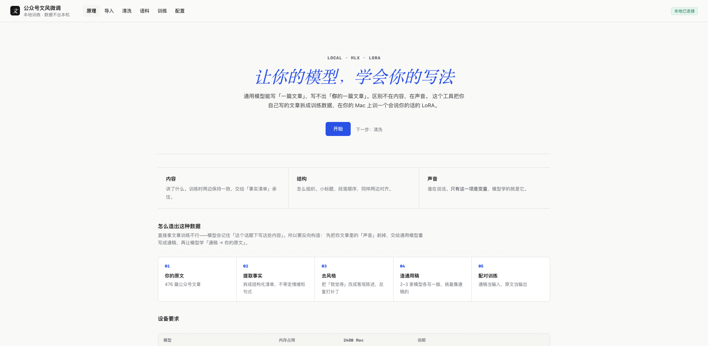
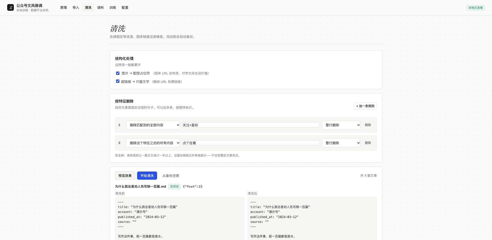
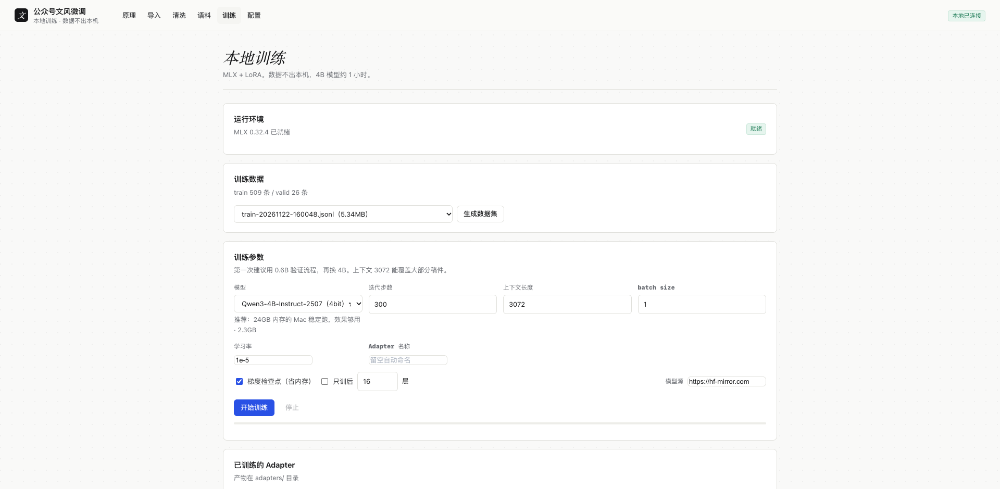
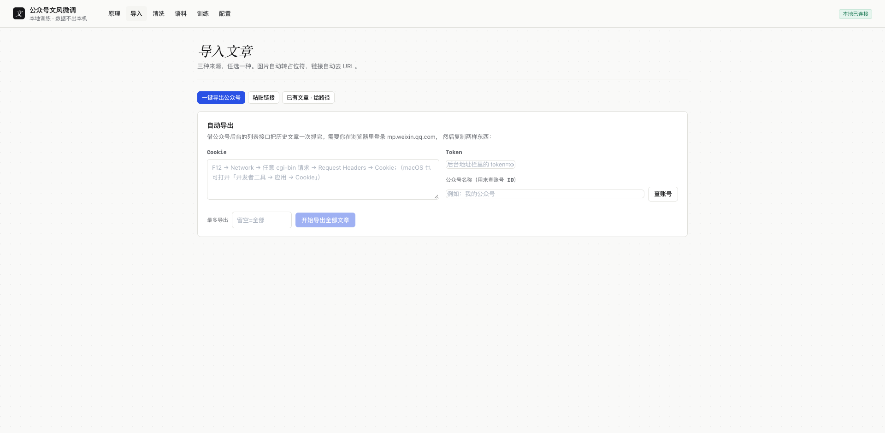

# 我用自己的 476 篇公众号文章，微调了一个改写模型

先说结果。

一个 4B 的模型，拿着别人写的通用稿，能改写成我的写法：用第一人称讲话、有具体数字、带态度、不写「总而言之」。

后来我把这套流程做成了一个开源工具，在本地网页里点几下就能跑完。下面既是复盘，也是说明书。



---

## 一、起点：所有 AI 写的稿子，都像同一个人写的

你可能也有这个体验：丢给 AI 一段材料，让它「写篇文章」，出来的东西第一眼挺唬人，第二眼就腻。

短句配短句，工整小标题，「总而言之」收尾，从头到尾没有一个人在里面。换个题目再生成一次，还是那个调调。

问题不在能力，在**声音**。模型的训练数据里没有「我」这个人，它只能产出一个平均值。

我写了 476 篇公众号，从 2023 年到现在。这里面有我的口头禅、我的比喻、我骂人的方式、我收尾的习惯。这些东西没法用 prompt 描述清楚——「犀利一点」是你的犀利还是我的犀利？

所以我决定不描述，让它学。

---

## 二、关键决定：不是教它写，是让它「复述」我

一开始我想得很直接：拿我的文章去训练，让它照着写。

后来发现不行。因为微调的本质是**学输入到输出的映射**，如果输入是「随便一个话题」，输出是「我的文章」，那模型学到的是「在这个话题下，这几千个字」。它记住的是内容，不是写法。

真正有效的做法是**反向构造**：

> 拿我的文章，先剥掉「我的声音」，只留事实和结构；交给通用模型重写成一篇「通稿」；再把通稿当输入、我的原文当输出。

这样一对训练数据的差别，就只剩**说话方式**。

这个思路的核心，是把三个东西拆开：

| | 谁决定 | 训练时怎么办 |
|---|---|---|
| **内容**（讲了什么） | 选题 | 两边保持一致 |
| **结构**（怎么组织） | 逻辑 | 两边保持一致 |
| **声音**（谁在说话） | 你 | **只有这一项是变量** |

我管它叫「三解耦」。后面所有工程问题，本质都是在保这一条：**如果 AI 稿和我的原文除了声音以外还有别的差异，模型就会学歪。**

举个具体的翻车：第一版数据我偷懒，去风格只把「我觉得」换成「可以认为」，把「我上周」换成「最近」。结果模型学到的是「把第一人称换成第三人称」——方向正好反了。

---

## 三、数据是怎么造出来的

流水线五步：

**1. 分类**——把文章分成年份、类型、有没有软广。2023 年之前的不学（那时候的文字我已经不认了）。

**2. 提取事实**——把文章拆成结构化事实清单，每条不超过 40 字，引用原文用「」标出。这一步最难，因为模型天然爱总结、爱加戏。

**3. 去风格**——逐字段检查，把描述性、带情绪的表达换成平铺直叙。反复打补丁：极端样本从 55 处泄漏清到 0，花了 4 轮。

**4. 造通用稿**——三家模型（DeepSeek、MiMo、豆包）各写一版，同样的 prompt。三家都不一样，正好给我挑。

**5. 裁判打分**——用 rubric 选出最像「通稿」的那篇。裁判标准改到 v6 才好用：早期它一直在扣「没有小标题」「没有结尾号召」，而那些恰恰是我要去掉的东西。

最后得到 **535 对训练数据 + 86 对评测数据**。

清洗这一步也没法省。624 条输出里有 380 条结尾带着「关注+星标+进群」，那是公众号的固定尾巴，不是文风。不清掉，模型会给所有稿子加这个收尾。



> 上图是工具里的清洗页：可以叠加多条规则，「删除特征之前/之后」配合「整行删除」，一次洗完。
> 安全阀会拦住那些「会把正文砍掉一半」的规则，避免批量操作把语料洗没。

---

## 四、没有指标的微调就是玄学

这是我最想强调的一点。

模型训完，它会给你一段文字，你读一遍：「嗯……好像有点像？又好像不太像。」

然后你开始调参数，再训一次，再读一遍。三天过去，你什么也没确定。

所以我一开始就定了四个可量化的指标：

| 指标 | 怎么算 | 说明什么 |
|---|---|---|
| **长度比** | 生成字数 ÷ 原文字数 | 稳定低于 0.8 = 模型在偷懒压缩 |
| **重合度** | 与输入的最长公共子串 | 超过 25 字 = 在照抄输入 |
| **第一人称密度** | 「我」出现次数 | 掉到 2 以下就是写成通稿了 |
| **小标题数** | Markdown 标题行数 | 你的原文几乎不用小标题 |

第一个和第三个是关键。**长度对了但「我」没了，就是典型的「形似神不似」**——它抄了你的段落长度，没抄你说话的方式。

指标本身也会骗人，我踩过两次：

**第一次**：指标报「最长公共子串 63 字」，我以为模型在照抄。查了半天发现是度量写错了——它把我提取的事实清单里的专有名词也算进了重合度。事实本来就该一致，怎么能算抄袭？

**第二次**：评测脚本默认取前 12 条样本，我拿这个数字做了半天判断。后来才发现这 12 条恰好是「我」密度最高的（平均 13.3 次），而全部 86 条的平均只有 7.8。样本选偏了，结论就偏了。

---

## 五、先在小机器上试，再去云端放大

我的笔记本是 M4，24GB 统一内存。

这个配置能跑多大？实测下来：4B 舒服，8B 贴着上限，14B 别想。而且一开始训练就 OOM——跑到第 129 步炸的，Metal 直接报 `kIOGPUCommandBufferCallbackErrorOutOfMemory`。

加上梯度检查点之后峰值从 8.7GB 降到 4.7GB，能跑了，但速度是 56 token/s。

所以我的路线是：**本地用 0.6B 和 4B 做小规模验证**（120 步，几十分钟），确认数据和指标是对的；再去云端租 24GB 卡跑完整训练。

本地那一轮的结果给了我信心：文风距离从 0.851 降到 0.50，15 个样本里 13 个变好。虽然还糙，但方向对了。

后来这套「小模型验证 → 大模型正式跑」的节奏被固化进了工具里：



---

## 六、真正花时间的是这些坑

说实话，训练本身只占三成时间。剩下七成是工程问题，而且每一个都能让你卡两小时。挑四个最值得说的。

### 坑 1：5.02 GiB 显存去哪了

第一次云端训练，18 秒就 OOM：

```
torch.OutOfMemoryError: CUDA out of memory. Tried to allocate 5.02 GiB
```

我第一反应是模型太大。但算一下：

```
5.02 GiB ≈ 8192（序列长） × 16.4 万（词表） × 4 字节（fp32）
```

这是**整个词表的 logits 转成 fp32** 的张量。跟模型大小无关，是长上下文必然的代价。

所以我之前的判断错了：不是模型太大，是序列太长撑不住。把 batch 降到 1 之后，问题就消失了。

> 教训：OOM 的时候先把 `Tried to allocate X GiB` 拿去算一下，看看到底是谁在吃内存。

### 坑 2：一个斜杠，让模型开始胡说

评测第一次跑出来，三个不同 checkpoint 的指标**一模一样**，长度比 2.39，第一人称 0.2，输出是一屏英文的 `Thinking Process`。

不是模型没学到，是我 prompt 里写错了一个 token。

Qwen3.5 的对话模板把「空思维链」放在 prompt 里，关闭思考时必须是：

```
<|im_start|>assistant
<think>

</think>

```

我手滑，多写了一个斜杠，被 tokenizer 切成了 4 个垃圾 token：

| 写法 | token 数 |
|---|---|
| `<think>`（7 字符） | **1 个**（id 248068） |
| 多一个斜杠的 8 字符写法 | 4 个垃圾 token |

模型看到一堆乱码，直接进入思考模式，一屏推理全吐出来。

> 教训：这类「格式类 bug」最阴险，因为训练 loss 照常下降，看起来一切正常。唯一的排查办法是**把 prompt 打印出来，和官方模板逐字节比**。

### 坑 3：一句「不要新增事实」，把「我」杀死了

第二轮训完，各项指标都正常，就是**第一人称从 0 变不出来**。

我去查数据：训练集里我的原文「我」出现 7 次（中位），AI 稿是 0 次。模型的任务就是「把无人称的稿子改写成第一人称」。

那为什么学不会？

因为 system prompt 最后一句：**「保留原文全部事实、数字与专名，不要新增任何事实。」**

对模型来说，「我说我干了什么」就是在新增事实。这句话把它吓住了。

改成「不要**编造**原文没有的具体数字或事实，**但可以用「我」表达观点和经历**」之后，同一批权重，「我」从 2 涨到 5，小标题从 5 个变成 0 个。

> 教训：**负向指令要划清边界。**「不要做 X」容易被模型扩写成「不要做所有像 X 的事」。

### 坑 4：导出的模型在 Ollama 里死活加载不了

训完导出 GGUF，丢进 Ollama，报 `tensor 'blk.0.ssm_beta.weight' not found`。

原因是版本错配：llama.cpp 新版把 Qwen3.5 的两个共享输入权重合并了（`ssm_beta + ssm_alpha → ssm_beta_alpha`），而 Ollama 内置的 llama.cpp 比较旧，还按老名字找。

解法是关掉转换时的合并逻辑，产出老式布局。新版运行时两种名字都认，所以未合并的文件新旧通吃。

顺便还有个坑：Ollama 0.40 会把输出自动归类，不显式关闭思考的话，正文全被塞进 `thinking` 字段，`content` 返回空——你会以为模型没说话。

---

## 七、结果，和还没解决的事

最终这一版：Qwen3.5-4B，LoRA rank 32，4 个 epoch，1072 步。

拿两个评测样本实测：

| | 生成 | 我写的原文 |
|---|---|---|
| 样本 1 | 2008 字，**「我」出现 8 次** | 2046 字，「我」12 次 |
| 样本 2 | 2411 字，**「我」出现 10 次** | 2046 字，「我」12 次 |

上一版同样的指标是 **2 次**。

生成的开头长这样：

> **「过剩」不是「暂时失业」，而是「被时代抛弃」。**
>
> 前段时间看《工作、消费主义和新穷人》这本书……深感忧心的同时，又觉得特别「扎心」。

长度准了，声音回来了，「总而言之」没了。

**还没解决的：**

- **小标题还是偏多**。生成 4 个，我的原文 0 个。4B 的容量到这里有点吃力，下次要么在 prompt 里硬约束，要么把带小标题的样本从数据里剔掉
- **「我」到 10 就上不去**。目标 12。差的那两次，是那种需要具体生活细节的段落，模型不敢编

---

## 八、所以我把整条流程做成了工具

踩完这些坑，最直接的想法是：**下次不该再踩一遍。**

所以我把「导入 → 清洗 → 造语料 → 训练」四步做成了一个本地网页工具。全部零依赖（Python 标准库），数据不出本机。



几个我觉得值得的取舍：

**1. 一键导出，而不是一篇篇粘链接。** 借公众号后台的列表接口（`cgi-bin/appmsg`），填 Cookie + Token 就能把你自己的号全部导下来。只想抓几篇也行，粘链接即可。

**2. 清洗规则只留三个动作，但能叠加。** 再复杂的规则用户自己也说不清。三条够用的动作 × 无限条规则，覆盖了绝大多数导流语。

**3. 安全阀。** 批量清洗最怕一条规则把整批文章洗没。现在如果某条规则让正文减少一半以上，这篇会被跳过并单独提示。

**4. 指标写进界面。** 不要求你去写脚本算，四个指标直接在页面里给。

**5. 国内网络友好。** PyPI 走阿里云镜像，模型走 hf-mirror，不用科学上网。

仓库在这里：[github.com/comeonzhj/wechat-style-finetune](https://github.com/comeonzhj/wechat-style-finetune)

---

## 九、如果重来一次

我会把顺序改成这样：

1. **先定指标，再动数据。** 没有可量化的验收标准，你会无限期陷在「感觉还行」里
2. **先跑通最小闭环。** 0.6B、120 步、15 个样本，一晚上就能验证方向对不对
3. **把 prompt 当代码审。** 打印出来逐字节比，别相信「应该没问题」
4. **给工程问题留一半预算。** 显存、版本、模板、量化格式，这些不是学习的障碍，是必经的路
5. **数据质量 > 模型规模。** 535 对精挑细选的数据，比几万条爬来的强。我最后一轮提升最大的改动，是把 system prompt 里一句话改清楚，不是换模型

最后说个感受。

文风这件事，本质上是可拆的。「我」多少、「你」多少、句子多长、有没有小标题、怎么收尾——这些都能数出来，也就能度量、能优化。

真正不能被替代的，是你为什么这么写。模型学到的是「我说『我觉得』的时候后面跟一个判断」，学不到「我为什么在这个地方判断」。

所以它现在能把我从「写稿」里解放出来，但不能替我「想」。

这大概是个不错的结局。
